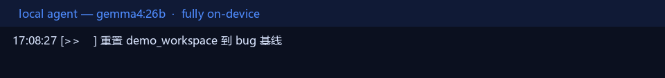
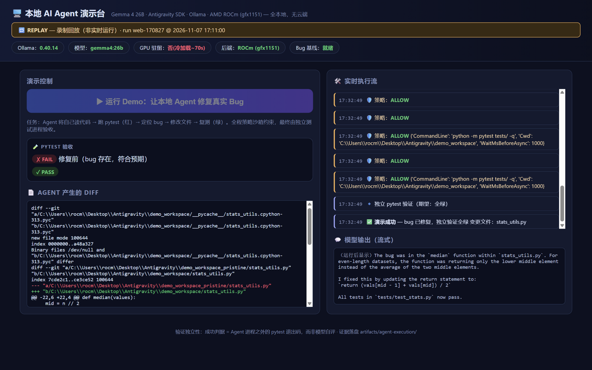

# Antigravity-Gemma-ROCm

**A fully local AI coding agent on Windows — AMD ROCm first (Ryzen AI MAX 395/495), works with any Ollama model on ROCm/Vulkan/CUDA/CPU.**

[](https://github.com/AIwork4me/Antigravity-Gemma-ROCm/actions/workflows/ci.yml)
[](LICENSE)
[](requirements.txt)
[](ruff.toml)

[中文说明见 README.zh-CN.md](README.zh-CN.md)



Given a natural-language mission, a **local Gemma model served by Ollama** and driven by
the Google Antigravity SDK **really executes tools** — lists, reads and edits files, runs
pytest — inside a locked-down workspace, fixes a seeded bug in a real Python project, and
an **independent verification process** proves it: tests red before the run, green after,
with byte-exact diffs and SHA256 trails recorded end to end. Zero cloud, zero API spend,
verifiable offline.

> **What this is not:** the *Antigravity IDE/desktop app* is Google's agentic dev
> environment. This project uses only the **Antigravity Python SDK**
> (`pip install google-antigravity`) wired to a local Ollama server — the IDE is neither
> required nor launched.

## Why it matters

- **Cost** — every token is generated on-device. No API key, no metering.
- **Privacy** — your code never leaves the machine (loopback-only sockets verified during
  inference; no cloud fallback in the SDK for local configs).
- **Reliability** — works without internet. Software-level isolation is proven; the
  physical-disconnect procedure is documented in
  [docs/OFFLINE_VALIDATION.md](docs/OFFLINE_VALIDATION.md).
- **It's a real agentic loop** — actual tool calls through the SDK harness, audited by a
  policy sandbox. Not a chat demo, not mocked.

## ROCm on Windows: official docs vs what we measured

- AMD's and Ollama's official docs list **Windows ROCm support for RX 7000+ dGPUs**;
  the Ryzen AI MAX iGPU (gfx1151) is listed for **Linux** only.
- **Measured (Ollama 0.40.x, reproducible):** the bundled `rocm_v7_1` runner detects and
  runs gfx1151 **natively on Windows by default** — confirmed by server logs
  (`library=ROCm compute=gfx1151`), runtime ROCm scheduler buffers, HIP DLLs loaded in
  the runner process, and correct outputs across a 49K-token regression. The Vulkan
  backend was separately force-tested as the documented fallback
  ([docs/GPU_BACKEND_VALIDATION.md](docs/GPU_BACKEND_VALIDATION.md)).
- We report exactly this: **measured facts, not vendor support promises.** If you run a
  Strix Halo machine (Ryzen AI MAX+ 395/495, 64–128 GB unified memory), this repo gives
  you a verified recipe to put it to work on local agents.

## Quick start

```powershell
# 1) Ollama (official winget package)
winget install --id Ollama.Ollama -e --accept-source-agreements --accept-package-agreements

# 2) Model (~18 GB; reference = gemma4:26b)
ollama pull gemma4:26b

# 3) Project deps (isolated venv — never touches your base Python)
#    Python 3.12-3.13 are the CI-tested versions (SDK floor is 3.10)
git clone https://github.com/AIwork4me/Antigravity-Gemma-ROCm.git
cd Antigravity-Gemma-ROCm
python -m venv .venv
.\.venv\Scripts\python.exe -m pip install -r requirements-dev.txt

# 4) Check & run
.\scripts\preflight.ps1      # PASS/FAIL/BLOCKED readiness gate (auto-restores workspace)
.\scripts\start-demo.ps1     # full live demo: agent fixes a seeded bug, tests go red -> green
```

**Smaller GPU / different model?** Any Ollama model with tool-call support works:

```powershell
$env:AGENT_MODEL = "your-model:tag"   # picked up by every script
```

The reference experience is measured on `gemma4:26b` (25.2B MoE, 3.8B active, ~31 GB GPU
memory). Lighter tool-capable models from the
[Ollama library](https://ollama.com/library) should run on smaller cards — those paths
are **community tier**: try one and
[report your hardware](.github/ISSUE_TEMPLATE/hardware_report.md) so the table below
grows.

> `scripts/pull_parallel.py` (IPv4, chunked, sha256-verified registry pull) is a
> **fallback for networks where `ollama pull` stalls on broken IPv6 routes** — not part
> of the default install path.

## Web dashboard (live + REPLAY)

```powershell
.\scripts\start-web-demo.ps1                      # http://127.0.0.1:8420
# record a run for video / GIF / on-stage fallback:
.\.venv\Scripts\python.exe -I src\webui.py --record run.json
# replay it later — clearly labeled REPLAY, live runs disabled meanwhile:
.\.venv\Scripts\python.exe -I src\webui.py --replay run.json --replay-speed 1.5
```



Live status chips (server / model residency / **backend incl. ROCm detection** /
workspace baseline), a RUN button that executes the real task in-process, and an SSE
stream showing stages, tool calls, **policy decisions**, model tokens, pytest red→green
and the final diff. REPLAY mode replays a recorded event stream with a visible banner —
the recording in [`evidence/flagship-run/webui-recording.json`](evidence/flagship-run/)
is exactly that.

## Architecture

```
┌───────────────────────────────────────────────────────────────────┐
│ Windows 11 (Ryzen AI MAX+ 395, 128 GB unified memory)             │
│                                                                   │
│  demo driver (src/demo_agent.py) / web dashboard (src/webui.py)   │
│      │ LocalOpenAIAgentConfig(model=AGENT_MODEL).lightweight()    │
│      ▼                                                            │
│  google-antigravity SDK 0.1.23 ── harness: bin/localharness.exe   │
│      ├─ tools: view_file / create_file / edit_file / run_command  │
│      ├─ B1 file boundary : paths must resolve inside workspace    │
│      ├─ B2 shell boundary: structured pytest-only allowlist + Cwd  │
│      └─ OpenAI-compatible HTTP ──► Ollama @ 127.0.0.1:11434       │
│                                       └─ rocm_v7_1 runner         │
│                                            └─► Radeon 8060S       │
│                                                (gfx1151, HIP)     │
└───────────────────────────────────────────────────────────────────┘
```

| Component | Responsibility |
|---|---|
| **Gemma (or your model)** | reasoning, code understanding, tool-call decisions |
| **Ollama** | inference server + model store; OpenAI-compatible API; GPU runners |
| **AMD ROCm/HIP** | GPU compute: llama.cpp HIP kernels via Ollama's bundled rocm_v7_1 runner |
| **Antigravity SDK** | agent harness: tool execution, policy engine, streaming — the "hands" |
| This repo | locked-down config, demo workspaces, scenarios, verifiers, evidence |

## Measured on the reference machine

ASUS ProArt PX13 — Ryzen AI MAX+ 395 (16C/32T), Radeon 8060S (gfx1151), 128 GB unified
memory, driver 32.0.22032.6002, Ollama 0.40.x, **ROCm backend by default**.

| Item | Value |
|---|---|
| Model | `gemma4:26b` — 25.2B MoE (3.8B active), Q4_K_M, 256K ctx, tools+thinking |
| Cold load | ~52–73 s (resident afterwards; keep-alive default 5 min) |
| Warm request | ~1 s (prompt cache) |
| Generation | ~48–50 tok/s short ctx; ~27 tok/s @ 49K-token prompts |
| GPU memory | ~31 GB committed (30.98 GB measured, weights + KV + compute) |
| Bug-fix task | **10/10 success**, 64–107 s per run (avg 87 s) |
| Long-context | correct up to 49.4K prompt tokens (text / JSON / tool modes) |

Full methodology: [docs/GEMMA4_GFX1151_REGRESSION.md](docs/GEMMA4_GFX1151_REGRESSION.md),
[docs/COMPATIBILITY_MATRIX.md](docs/COMPATIBILITY_MATRIX.md).

## Hardware compatibility

| Machine / GPU | Backend | Status |
|---|---|---|
| **AMD Ryzen AI MAX+ 395** (Radeon 8060S, gfx1151) | ROCm | ✅ **measured** — default runner on Windows ([A/B evidence](docs/GPU_BACKEND_VALIDATION.md)) |
| AMD Ryzen AI MAX+ 395 | Vulkan | ✅ **measured** — documented fallback, force-tested |
| AMD Ryzen AI MAX+ 495 | ROCm | 🟡 expected — same gfx1151-class iGPU; **community confirmation welcome** |
| Other AMD GPUs (RX 7000+) | ROCm | 🟡 expected — officially supported tier for Windows |
| NVIDIA | CUDA | 🟡 community tier |
| Any CPU | CPU | 🟡 community tier (slow; expect minutes per tool step) |

Ran it somewhere? Open a [hardware report](.github/ISSUE_TEMPLATE/hardware_report.md) or
PR a row into this table — that's how the 🟡 rows turn ✅.

## Security boundaries (the honest version)

- **Three policy boundaries** guard the agent: file-path authorization
  (reparse-point-aware workspace resolution); shell-process permission (structured,
  fail-closed validation of executable + arguments + in-workspace `Cwd` — only
  `python -m pytest` / `pytest` invocations pass; unknown schemas, arbitrary scripts,
  `-c` code evaluation and any shell metacharacter are denied); and the loopback web
  dashboard (Host/Origin/CSRF checks, non-blocking SSE, validated replay input).
  Red-team suites: `tests/test_security_boundaries.py` (junction escape, `..`
  traversal, `\?\` paths, metachar injection, Cwd redirection, prefix lookalikes, …)
  and `tests/test_webui_http.py` (cross-origin run attempts, DNS rebinding, replay
  bounds).
- **No OS-level sandbox** exists for the SDK's shell subprocesses on Windows, and a
  pytest allowlist is not a sandbox — pytest runs whatever test code sits in the
  workspace. Keep the demo in its disposable workspace; for arbitrary imported repos
  use `build_config(enable_shell=False)` or add human approval plus a low-privilege
  account. Details: [SECURITY.md](SECURITY.md).
- Physical network isolation requires manual action; the software-level isolation proof
  and the manual procedure are in
  [docs/OFFLINE_VALIDATION.md](docs/OFFLINE_VALIDATION.md).

## Scenarios

Three graded bug-fix tasks ship in [`scenarios/`](scenarios/), each with a pristine
workspace and, where useful, mutants for test-writing tasks:

- **A_boundary** — fix a logic bug in `textutils.py` (entry-level)
- **B_writetests** — write a pytest suite that kills three seeded mutants (test quality)
- **C_excfix** — diagnose and fix a crash from a real `crash.log` (stack-trace reading)

Multi-task validation results: [docs/MULTI_TASK_AGENT_VALIDATION.md](docs/MULTI_TASK_AGENT_VALIDATION.md).

## Reproducibility & evidence

```powershell
.\scripts\run-tests.ps1                                # unit + API smoke + live agent tests
.\.venv\Scripts\python.exe -m pytest -q                # unit + security red-team (no model needed)
.\.venv\Scripts\python.exe -m pytest -m live -q        # live agent tests (needs model loaded)
.\.venv\Scripts\python.exe src\regression_ctx.py --full  # long-context regression
```

Start with [`evidence/flagship-run/`](evidence/flagship-run/) — one complete proof:
mission → tool calls → policy audit → pytest red/green → SHA256 before/after → diff.
The **full evidence tree** (345+ files: backend A/B probes, 10-run stability matrix,
offline isolation proof, independent RC1 audit) ships as
`evidence-bundle-v1.0.0.zip` on the [v1.0.0 release](../../releases), inner
`SHA256SUMS.txt` included. Deep-dive reports live in [docs/](docs/):
[RC1_INDEPENDENT_AUDIT](docs/RC1_INDEPENDENT_AUDIT.md) ·
[SECURITY_BOUNDARY_REVIEW](docs/SECURITY_BOUNDARY_REVIEW.md) ·
[OFFLINE_VALIDATION](docs/OFFLINE_VALIDATION.md) ·
[STABILITY_AND_OFFLINE_REPORT](docs/STABILITY_AND_OFFLINE_REPORT.md) ·
[TROUBLESHOOTING](docs/TROUBLESHOOTING.md).

## Roadmap

- **v1.1** — more scenarios (refactor task, multi-file fix); ask-a-human policy handler
  demo; lighter-model guidance table from community reports
- **v1.2** — Linux CI leg; containerized evidence verification; benchmark harness
  comparing local models on the same tasks

Contributions welcome — start with [CONTRIBUTING.md](CONTRIBUTING.md). The fastest
first PR is a hardware-table row.

## Talk & credits

This project premiered at a GDG DevFest talk on fully-local AI coding agents
(ROCm + Gemma + Antigravity SDK on Ryzen AI MAX). Built on the shoulders of:
[Gemma](https://ai.google.dev/gemma) · [Ollama](https://ollama.com) ·
[AMD ROCm](https://www.amd.com/en/products/software/adrenalin/rocm.html) ·
google-antigravity SDK.

## License & attribution

- This repo: project code is MIT; docs CC-BY-4.0 (see [LICENSE](LICENSE)).
- `google-antigravity` SDK: Apache-2.0 (Google LLC) — installed from PyPI.
- Model weights (e.g. `gemma4:26b`) are served via Ollama under their own terms and are
  **not** redistributed in this repo.
