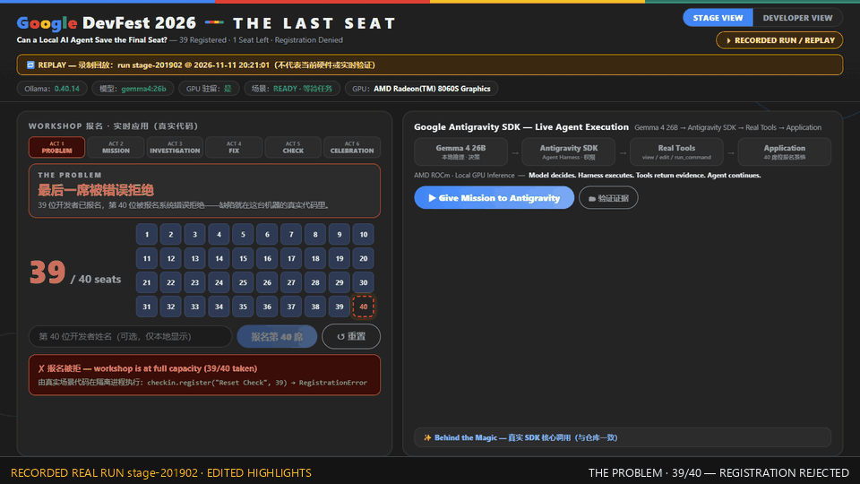
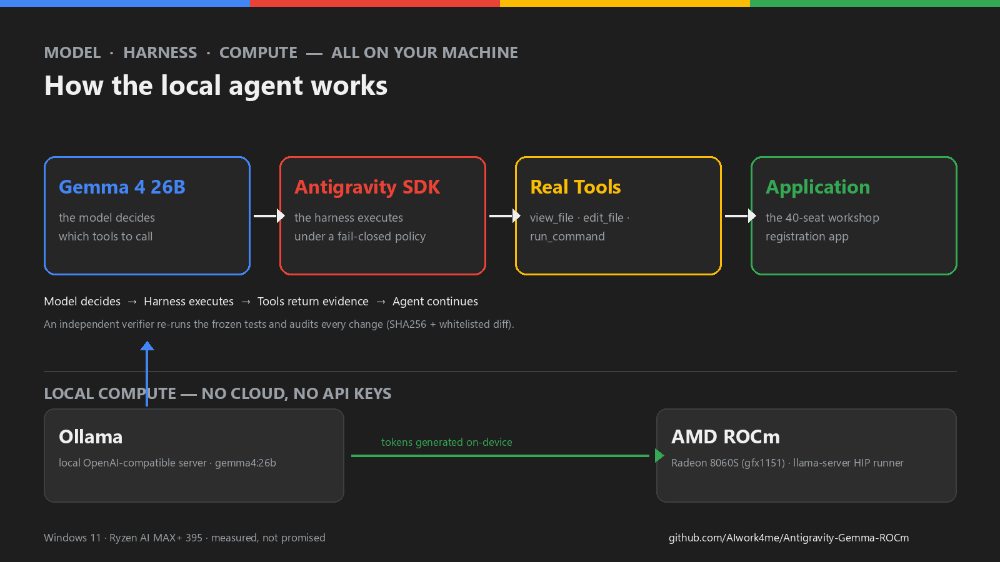

# 你的电脑。你的模型。你的 Agent。

**在 AMD ROCm 上本地运行 Google Gemma 4 —— 并用 Google Antigravity SDK 搭一个真正会干活的编程 Agent。**

[](https://github.com/AIwork4me/Antigravity-Gemma-ROCm/actions/workflows/ci.yml)
[](LICENSE)
[](requirements.txt)
[](ruff.toml)


[English](README.md) | **简体中文**



**39/40 个席位，一次被错误拒绝的报名。** 本地 AI Agent 读懂代码、修掉 bug、跑通测试
——救回最后一席。
*真实运行录制（`stage-201902`）· 剪辑精选（1.5× 回放、分幕剪辑）· 画面来自真实舞台 UI——
见[捕获元数据](docs/assets/devfest-last-seat-hero.meta.json)与
[静态海报](docs/assets/devfest-last-seat-poster.png)。*

- **不需要云端模型 API** —— 每个 token 都由本地 GPU 上的 Gemma 4 26B 生成。
- **真实工具调用** —— `view_file` / `edit_file` / `run_command` 由 Google Antigravity
  SDK 在失败即拒的策略下实际执行。
- **结果可复现** —— 独立 pytest 红 → 绿、SHA256 审计、白名单 diff，每次运行的证据全部入库。

> **本仓库不是什么：** *Antigravity IDE/桌面应用* 是 Google 的 agentic 开发环境。
> 本项目只使用 **Antigravity Python SDK**（`pip install google-antigravity`）对接本地
> Ollama 服务——不需要、也不会启动那个 IDE。

---

## 1. 看它跑起来

上面的首屏循环是 **《The Last Seat》** 的真实录制——一个 Google DevFest 风格的舞台演示：
真实本地 Agent 修复真实报名应用里的真实 bug。六幕剧情**只由观测到的 SDK 事件推进**：

| 幕 | 你看到什么 | 背后依据 |
|---|---|---|
| THE PROBLEM | 第 40 位报名被**拒绝**——39/40 已满 | 真实报名探针（隔离 `python -I` 子进程） |
| THE MISSION | 任务交给本地 Agent | SDK 会话 + `agent.chat(mission)` |
| THE INVESTIGATION | `view_file` ×2、`run_command`——Agent 阅读代码与测试 | 真实 `response.tool_calls` 流 |
| THE FIX | `edit_file`——一处逻辑修正（`>= capacity - 1` → `>= capacity`） | 观测到的编辑 + 策略 ALLOW/DENY 审计 |
| THE CHECK | 独立 pytest：**1 failed → 9 passed**，SHA256 复核 | 冻结测试、白名单 diff |
| THE CELEBRATION | 第 40 席翻绿——**40/40 · YOU'RE IN!** | 验收 PASS **且**业务探针 PASS（同一次运行） |

完整舞台文档：[docs/DEVFEST_THE_LAST_SEAT.zh-CN.md](docs/DEVFEST_THE_LAST_SEAT.zh-CN.md) ·
[英文版](docs/DEVFEST_THE_LAST_SEAT.md) ·
[GO/NO-GO 台账](docs/DEVFEST_GO_NO_GO_LEDGER.md) ·
[全尺寸截图](docs/DEVFEST_THE_LAST_SEAT.md#stage-screenshots--recording-real-runs-2026-11-11)。

## 2. 为什么做这个项目？

- **真 Agent，不是聊天机器人。** 模型不是只给建议——harness 真的去读文件、改代码、
  跑 pytest；独立验证器重新执行冻结测试、逐字节审计变更，全部通过才显示成功。
- **模型推理完全本地。** Gemma 4 26B 经 Ollama 跑在你的 GPU 上。没有 API key、
  没有计费、只监听回环地址——断网也能继续工作
  （[软件级隔离验证](docs/OFFLINE_VALIDATION.md)）。
- **由 Google Antigravity SDK 驱动。** SDK harness 就是 Agent 的双手：工具执行、
  策略引擎、流式输出。本仓库展示真实 SDK 调用并把它锁死——见
  [src/config.py](src/config.py) 与 [src/devfest_agent.py](src/devfest_agent.py)。
- **Windows AI PC 上的 AMD ROCm。** 在 Ryzen AI MAX+ 395 / Radeon 8060S（gfx1151）
  上实测——我们只发布实测事实，不替厂商做支持承诺（见 §5–§6）。

## 3. 快速开始 —— 跑起来《The Last Seat》

前提：**Windows 11**、**Python 3.12 或 3.13**、**已安装并运行 Ollama**
（`ollama --version` 能出版本号；若未装：`winget install --id Ollama.Ollama -e` 或
[ollama.com](https://ollama.com)）、参考模型 `gemma4:26b`（约 18 GB 下载；运行时
实测运行占用：runner 工作集 40.6 GB——参考机为 128 GB 统一内存）。

```powershell
git clone https://github.com/AIwork4me/Antigravity-Gemma-ROCm.git
cd Antigravity-Gemma-ROCm

py -3.13 -m venv .venv          # 3.12 也可以——这两个是 CI 实测版本
.\.venv\Scripts\python.exe -m pip install -r requirements-dev.txt

ollama list                      # 仅当缺 gemma4:26b 时才需要下载：
# ollama pull gemma4:26b        # （约 18 GB；若 IPv6 路由损坏拉取卡住，用 scripts/pull_parallel.py）

powershell -ExecutionPolicy Bypass -File scripts\start-devfest-demo.ps1
```

脚本会先跑就绪预检、预热模型（首次预热约 60–75 秒），然后打开
**http://127.0.0.1:8421**。在舞台页上：

1. 输入名字 → 点 **报名第 40 席** —— 红色拒绝（bug 是真的，就在本仓库代码里）。
2. 点 **▶ Give Mission to Antigravity** —— 看六幕剧情随真实事件推进。
3. 随时切到 **DEVELOPER VIEW** 看技术回执：SDK 时间线、pytest 前后对比、SHA256、GPU 证据。

**还没有 GPU / 模型？** 两分钟看个明白的两种诚实方式：

```powershell
# 回放一次真实运行的录制（醒目标注 REPLAY，结束后也绝不冒充 LIVE）：
.\.venv\Scripts\python.exe -I src\devfest_webui.py --replay docs\assets\last-seat-recording.json --replay-speed 1.5

# 设计预览——合成的、明确标注的时间线，不需要 Ollama/GPU：
powershell -ExecutionPolicy Bypass -File scripts\start-devfest-demo.ps1 -DryRun
```

**其他演示**（全部保留可用）：最初的 median-bug Agent 演示
（[scripts\start-demo.ps1](scripts/start-demo.ps1)，Web 面板在 8420 端口）与三个分级
[场景](scenarios/)——见下方[其他演示与进阶场景](#其他演示与进阶场景)。

## 4. 工作原理



| 组件 | 职责 |
|---|---|
| **Gemma 4 26B**（或任意支持工具调用的 Ollama 模型） | 推理、理解代码、决定调用哪些工具——*模型做决策* |
| **Google Antigravity SDK** | Agent harness：工具执行、策略引擎、流式输出——*harness 去执行* |
| **真实工具** | `view_file` / `create_file` / `edit_file` / `run_command`，限定工作区、仅允许 pytest 的 shell 白名单 |
| **Ollama** | 本地 OpenAI 兼容推理服务 + 模型仓库；GPU runner |
| **AMD ROCm（HIP）** | Ollama 自带 `rocm_v7_1` runner 在 Radeon 8060S（gfx1151）上提供 GPU 算力 |
| **本仓库** | 锁定配置、舞台 UI + 演示工作区、验证器、逐运行证据 |

核心 SDK 接线（节选；可执行真相在 [src/config.py](src/config.py) +
[src/devfest_agent.py](src/devfest_agent.py)）：

```python
from google.antigravity import Agent, LocalOpenAIAgentConfig
from google.antigravity.hooks import policy

config = LocalOpenAIAgentConfig(
    model="gemma4:26b",  # 本地 Ollama（OpenAI 兼容端点）
    base_url="http://127.0.0.1:11434/v1",
    workspaces=[str(DEVFEST_WORKSPACE)],  # 唯一可写工作区
    policies=[policy.allow(t, when=in_workspace_path) for t in FILE_TOOLS]
    + [policy.ask_user("run_command", handler=pytest_only)],  # 失败即拒
).lightweight()

async with Agent(config) as agent:
    response = await agent.chat(MISSION)  # Gemma 4 决定调用哪些工具
    async for call in response.tool_calls:
        ...
```

验收从不看"Agent 自己说成了"：冻结测试必须字节一致、变更必须留在白名单内、磁盘
SHA256 必须与审计映射吻合、业务探针必须放行第 40 位开发者——且全部发生在同一次运行里。

## 5. 真实硬件实测

参考机型：ASUS ProArt PX13——Ryzen AI MAX+ 395（16C/32T）、Radeon 8060S（gfx1151）、
128 GB 统一内存、Windows 11、Ollama 0.40.x、Antigravity SDK 0.1.23，
**默认即 ROCm 后端**。

| 项目 | 数值 |
|---|---|
| 模型 | `gemma4:26b`——25.2B MoE（激活 3.8B），Q4_K_M，256K 上下文，tools+thinking |
| DevFest Agent 任务 | **6/6 全 PASS**（每次 78.7–115.0 秒、5–8 次工具调用）+ 3 次浏览器彩排——[台账](evidence/devfest-last-seat/validation_ledger.json) |
| Bug 修复任务（A_boundary ×10） | 10/10 成功，64–107 秒（平均 87 秒） |
| 长上下文 | 最多 49.4K prompt token 全对（文本 / JSON / 工具模式） |
| 生成速度 | 短上下文约 48–50 tok/s；49K token 提示下约 27 tok/s |
| 冷加载 / 热请求 | 约 52–73 秒 / 约 1 秒（提示缓存） |
| GPU 内存（三种口径，绝不混用） | 模型文件 **18.73 GB**（`/api/tags`）· runner 工作集 **40.58 GB**（`tasklist`，逐运行 `gpu_evidence.json`）· `/api/ps` size **2.92 GB** = Ollama 自身记账，**不是**模型占用 |

以上数字只针对本工作负载与本机型。舞台页绝不把 `/api/ps` size 当"模型显存占用"展示
——在这个版本上它实测就不是。完整方法学：
[GEMMA4_GFX1151_REGRESSION](docs/GEMMA4_GFX1151_REGRESSION.md) ·
[兼容性矩阵](docs/COMPATIBILITY_MATRIX.md) ·
[GPU 后端 A/B](docs/GPU_BACKEND_VALIDATION.md)。

**Windows 上的 ROCm——官方文档 vs 实测：** AMD 与 Ollama 官方文档只列出 Windows
ROCm 对 RX 7000+ 独显的支持；Ryzen AI MAX 核显（gfx1151）仅在 Linux 列表。
本机实测（Ollama 0.40.x，可复现）：自带的 `rocm_v7_1` runner 在 Windows 上
**默认即检测并以原生方式运行 gfx1151**——依据：服务端日志、运行时 ROCm 调度缓冲、
runner 进程加载的 HIP DLL，以及 49K token 回归的正确输出。我们只陈述实测事实，
不替厂商做承诺。

## 6. 试试你自己的 GPU

| 机型 / GPU | 后端 | 状态 |
|---|---|---|
| **AMD Ryzen AI MAX+ 395**（Radeon 8060S，gfx1151） | ROCm | ✅ **实测**——Windows 默认 runner（[A/B 证据](docs/GPU_BACKEND_VALIDATION.md)） |
| AMD Ryzen AI MAX+ 395 | Vulkan | ✅ **实测**——有文档记录的回退路径，已强制切换验证 |
| AMD Ryzen AI MAX+ 495 | ROCm | 🟡 预期——同 gfx1151 级核显；**欢迎社区确认** |
| 其他 AMD 显卡（RX 7000+） | ROCm | 🟡 预期——Windows 官方支持档位 |
| NVIDIA | CUDA | 🟡 社区档 |
| 任意 CPU | CPU | 🟡 社区档（慢；每步工具调用以分钟计） |

任何支持工具调用的 Ollama 模型都能驱动 Agent：

```powershell
$env:AGENT_MODEL = "your-model:tag"   # 所有脚本都会读取
```

更小的工具模型（[Ollama 模型库](https://ollama.com/library)）理论上可在更小的显卡上
运行——这些路径属于**社区档**：跑一个，然后
[提交硬件报告](.github/ISSUE_TEMPLATE/hardware_report.md)（或直接给上表加一行），
让 🟡 变 ✅。

## 7. 安全与边界（诚实版）

- **Agent 会真的执行工具——把它当成一个可审计的 shell，而不是沙箱。** 三层策略
  边界：感知 reparse point 的文件路径授权；结构化、失败即拒的 shell 许可（仅
  `python -m pytest` / `pytest` 形式且必须在工作区内——未知 schema、任意脚本、
  `-c` 执行、任何元字符一律拒绝）；仅回环的 Web 面板（Host/Origin/CSRF 校验、
  回放输入校验）。红队测试：[tests/test_security_boundaries.py](tests/test_security_boundaries.py)、
  [tests/test_webui_http.py](tests/test_webui_http.py)。
- ⚠️ **Windows 上的策略白名单不是 OS 级沙箱。** pytest 会执行工作区里的任何测试
  代码。请把演示留在一次性工作区；导入任意第三方仓库时用
  `build_config(enable_shell=False)`，或加人工审批 + 低权限账户。详见
  [SECURITY.md](SECURITY.md)。
- **回放永远有标注。** 录制驱动 UI 时带 REPLAY 横幅、RECORDED RUN 徽标，成功画面
  叠加水印；回放结束后绝不自我改标为 LIVE；回放期间 run/reset 端点一律拒绝。
  设计预览永不产生 `ok:true`。
- **离线：** 软件级隔离已被证明（死代理回环测试、无外呼推理）；物理断网流程需
  人工执行，见 [docs/OFFLINE_VALIDATION.md](docs/OFFLINE_VALIDATION.md)。
- Builder Pass 是**虚构纪念徽章**，不是入场凭证。
- 本演示任务 6/6 通过，不代表任意编程 Agent 任务的成功率。

## 8. 参与贡献

- **在你的 AMD GPU 上复现**并[提交硬件报告](.github/ISSUE_TEMPLATE/hardware_report.md)——最快的第一个 PR 就是给硬件表加一行。
- 通过 [Issues](https://github.com/AIwork4me/Antigravity-Gemma-ROCm/issues) 报 bug、边界问题与模型兼容性发现。
- 新增 Agent 场景（带冻结测试 + 验证器的分级任务）——见 [scenarios/](scenarios/)。
- 改进舞台 UI、文档或证据工具链——[CONTRIBUTING.md](CONTRIBUTING.md) 有环境说明。

## 9. 技术文档

- [The Last Seat 舞台演示深度文档](docs/DEVFEST_THE_LAST_SEAT.zh-CN.md)（[英文](docs/DEVFEST_THE_LAST_SEAT.md)、[GO/NO-GO 台账](docs/DEVFEST_GO_NO_GO_LEDGER.md)）
- [架构与安全边界](SECURITY.md) · [安全边界评审](docs/SECURITY_BOUNDARY_REVIEW.md)
- [GPU 后端验证（ROCm vs Vulkan A/B）](docs/GPU_BACKEND_VALIDATION.md) · [长上下文回归](docs/GEMMA4_GFX1151_REGRESSION.md)
- [多任务 Agent 验证](docs/MULTI_TASK_AGENT_VALIDATION.md) · [稳定性与离线报告](docs/STABILITY_AND_OFFLINE_REPORT.md)
- [离线验证流程](docs/OFFLINE_VALIDATION.md) · [兼容性矩阵](docs/COMPATIBILITY_MATRIX.md) · [故障排查](docs/TROUBLESHOOTING.md)
- 可复现性：[evidence/devfest-last-seat/](evidence/devfest-last-seat/)（精选逐运行产物 +
  [机器可读台账](evidence/devfest-last-seat/validation_ledger.json)）·
  [evidence/flagship-run/](evidence/flagship-run/) · 完整证据包见
  [Releases](../../releases)（内含 `SHA256SUMS.txt`）
- 媒体：首屏 GIF 可从真实 UI 再生——
  `scripts/capture_devfest_hero.py`（浏览器捕获舞台页回放真实录制；录制缺完整
  验收链时直接拒绝生成）。

## 其他演示与进阶场景

```powershell
.\scripts\preflight.ps1                    # 原演示的就绪检查
.\scripts\start-demo.ps1                   # median-bug Agent 演示（CLI + 证据）
.\scripts\start-web-demo.ps1               # Web 面板：http://127.0.0.1:8420（录制/回放）
.\scripts\run-tests.ps1                    # 单元 + API 冒烟 + live Agent 测试
.\.venv\Scripts\python.exe -m pytest -q    # 单元 + 安全红队（无需模型）
.\.venv\Scripts\python.exe -m pytest -m live -q   # live Agent 测试（需模型）
.\.venv\Scripts\python.exe src\regression_ctx.py --full   # 长上下文回归
```

[scenarios/](scenarios/) 内含三个分级修复任务：**A_boundary**（入门逻辑 bug）、
**B_writetests**（写测试杀死三个变异体）、**C_excfix**（从真实 `crash.log` 定位崩溃）。
路线图与历史见 [CONTRIBUTING.md](CONTRIBUTING.md)。

## 10. 致谢与许可

站在巨人的肩膀上：[Google Gemma](https://ai.google.dev/gemma) ·
[google-antigravity SDK](https://pypi.org/project/google-antigravity/)（Apache-2.0，
Google LLC）· [Ollama](https://ollama.com) · [AMD ROCm](https://www.amd.com/en/products/software/adrenalin/rocm.html)。
DevFest 风格舞台使用原创 CSS/SVG 几何图形与 Google 品牌色——不分发任何主办方模板
文件、Logo 或字体；本项目与 Google/AMD/GDG 的官方背书无关。

- 本仓库：项目代码 MIT；文档 CC-BY-4.0（见 [LICENSE](LICENSE)）。
- 模型权重（如 `gemma4:26b`）由 Ollama 按其自身条款分发，本仓库**不**再分发。

---

*Show the demo. Prove the result. Make it easy to reproduce.*
